# Checkpoint evidence - The Little Light

Project: 5 minute animated short built from scratch in C++ (pure C++ rasteriser + OpenGL).
GitHub link: <paste your repository URL here after pushing this folder>

## CP1 - Technical foundation (pure C++)  -  `cp1_raster.h`
**What are we building?** A film made only of primitives: Lumi, the creatures, the city and the tree.
**Algorithms implemented**
- Bresenham line (`thinLine`)
- Midpoint circle algorithm, filled (`midpointDisc`, used for small discs and light particles)
- Scanline polygon fill, even-odd rule, 4 sub-scanlines for anti-aliasing (`fillPolygon`)
- Alpha blending and additive blending (the glow of Lumi is additive light)
- Radial glow with quadratic falloff (`glow`)
**Screenshot:** `screenshots/t58.png` (Lumi sharing light, all drawn by the CP1 rasteriser)

## CP2 - Transformation and animation (pure C++)  -  `cp2_transform.h`, `scene.h`
- 3x3 homogeneous matrices: translate, rotate, scale, concatenation, point transform
- Matrix stack (`push/pop`): hierarchical models (Lumi: body -> tuft/eyes/feet; robot: torso -> head -> antenna; tree: trunk -> branches)
- Cubic Bezier curves (Bernstein form): tree branches, plant stem, mouths, light streams, bird flight path, antenna
- Keyframe animation: monotone cubic Hermite tracks for position, brightness, camera, zoom, expression
- Squash and stretch, walking bob, trembling, blinking, parallax camera (3 building layers)
**Evidence:** `screenshots/t95.png`, `t125.png`, `t148.png`, `t168.png` (different characters, same engine)

## CP3 - OpenGL integration  -  `cp3_opengl.h`, `main.cpp`
- `GLRenderer` implements the same `Renderer` interface using the OpenGL fixed pipeline
  (triangle fans, alpha blending, additive blending for light, 4x MSAA)
- GLFW window, real-time playback, pause/seek/speed, switch renderer with **R**
- `GLPresenter` uploads the CP1 framebuffer as a texture so both back-ends can be compared
**Evidence:** `screenshots/opengl_t58.png`, `opengl_t236.png` (rendered through OpenGL)

## Prototype and Final project
**What works**
- Complete 300 s timeline from the storyline: intro, 5 acts of helping (creature, robot, bird, plant, child),
  the sacrifice in the square, the return of the lights, the awakening and the final message
- Lighting story: cold blue-grey world, warm gold added whenever Lumi helps; Lumi dims with every act
- Emotion without dialogue: eyes, trembling, hesitation, brightness and camera work
- Playback is deterministic: every frame is a pure function of time, so seeking and video export are exact
**Known limitations / recommendations**
- No soundtrack is generated (the storyline suggests soft piano building to orchestra); add music in a video editor
- The OpenGL back-end uses the legacy fixed pipeline for simplicity; a shader version would be the next step
- The software renderer takes about 40 ms per frame (fine for export, slightly below real time for 60 fps)

## Screenshots
| | |
|---|---|
| 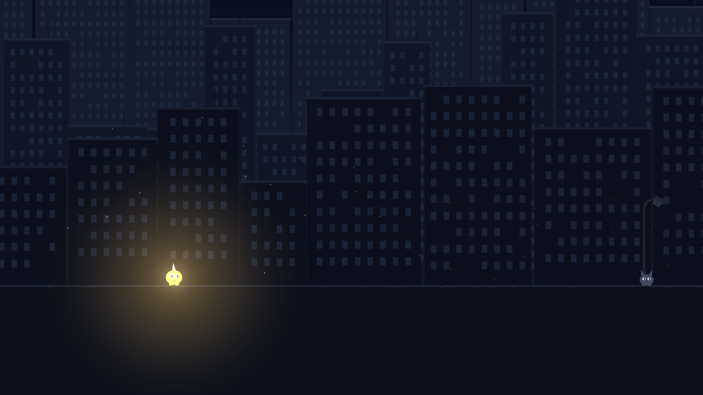 | 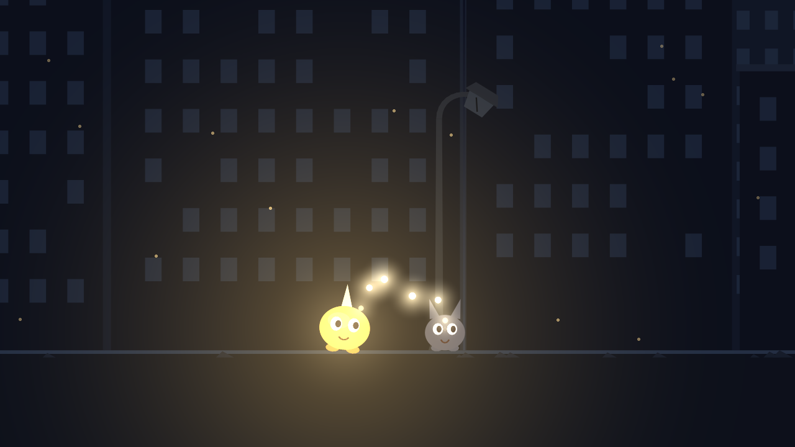 |
| 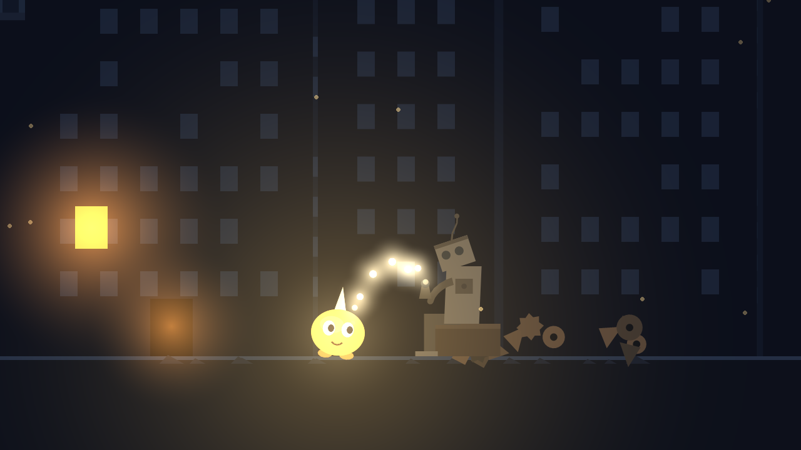 |  |
| 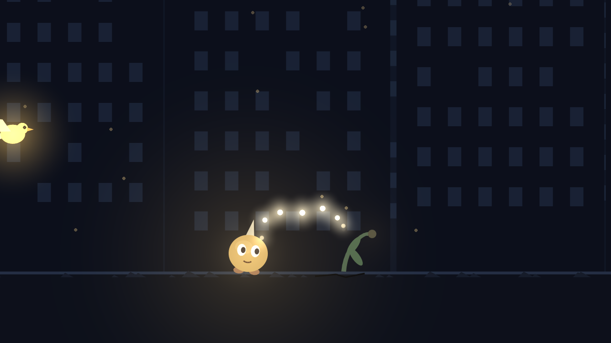 | 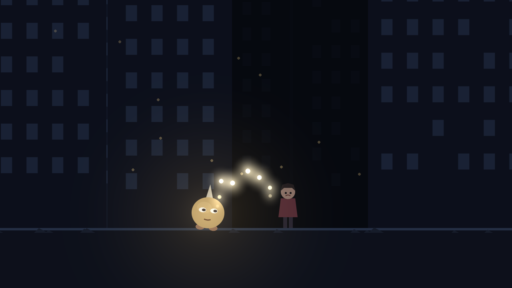 |
| 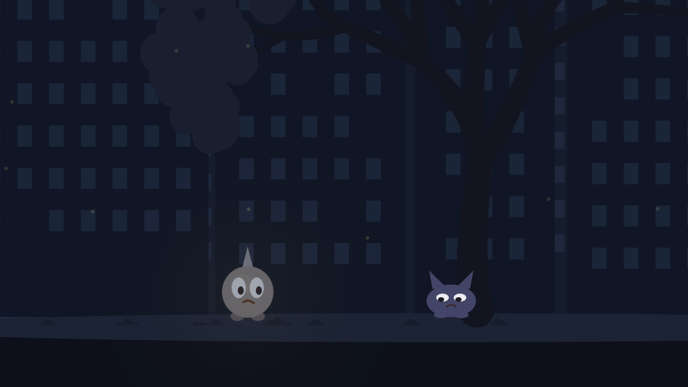 | 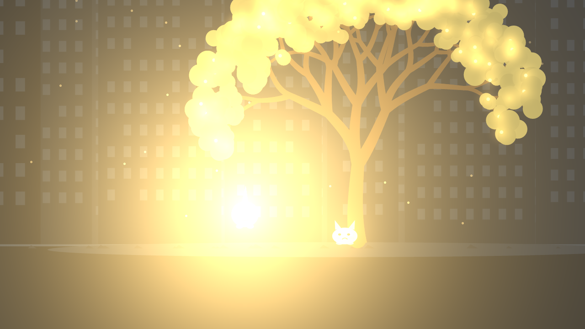 |
| 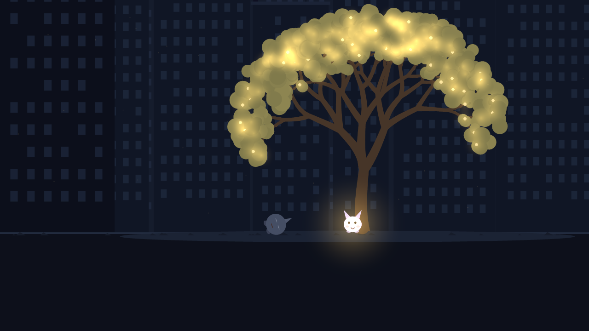 | 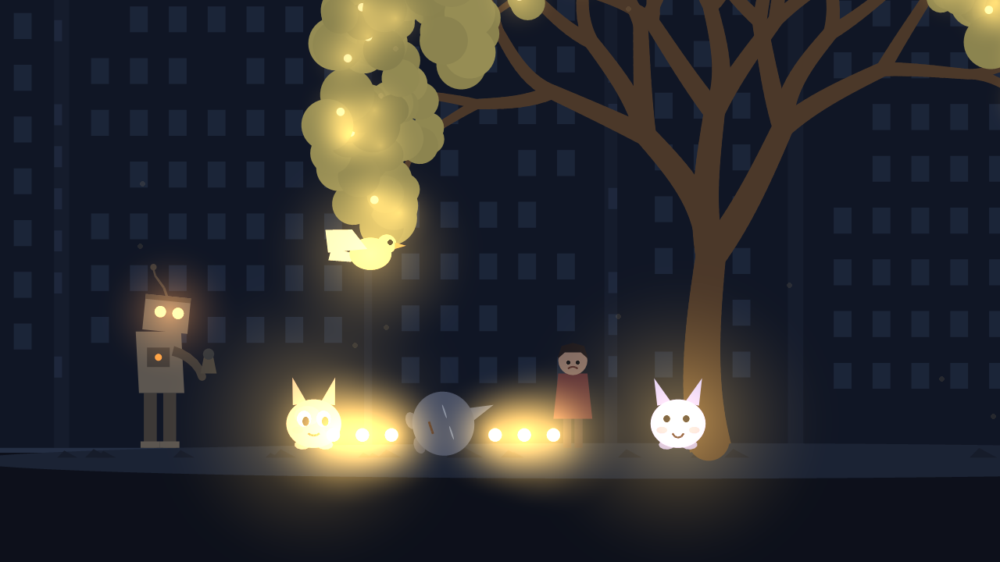 |
| 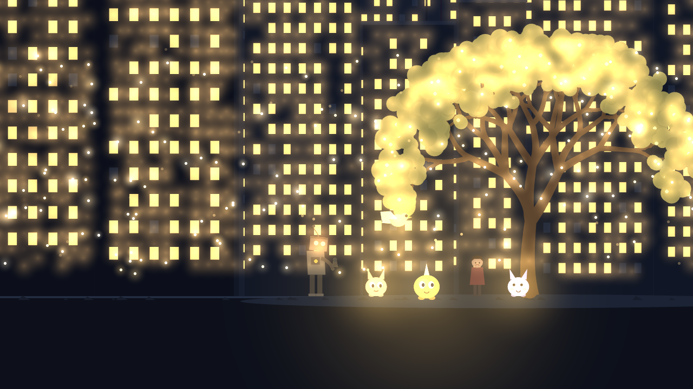 | 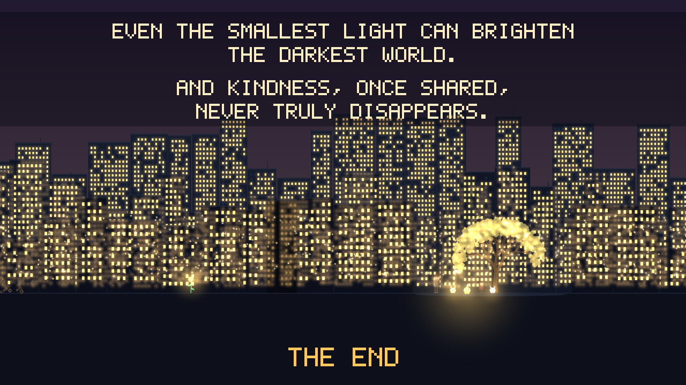 |
