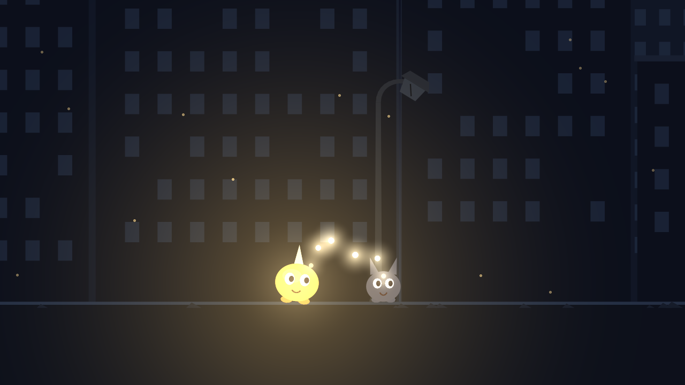
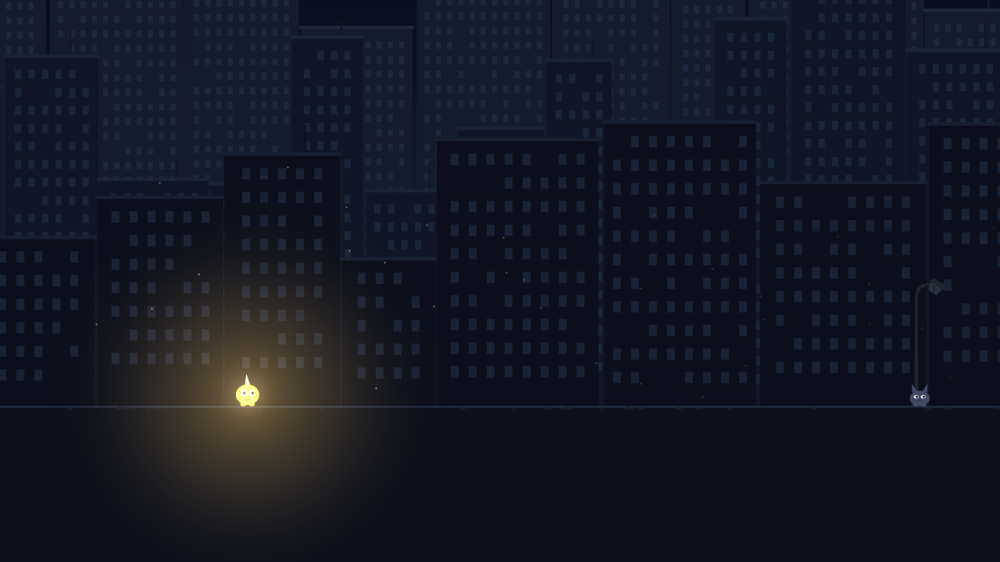
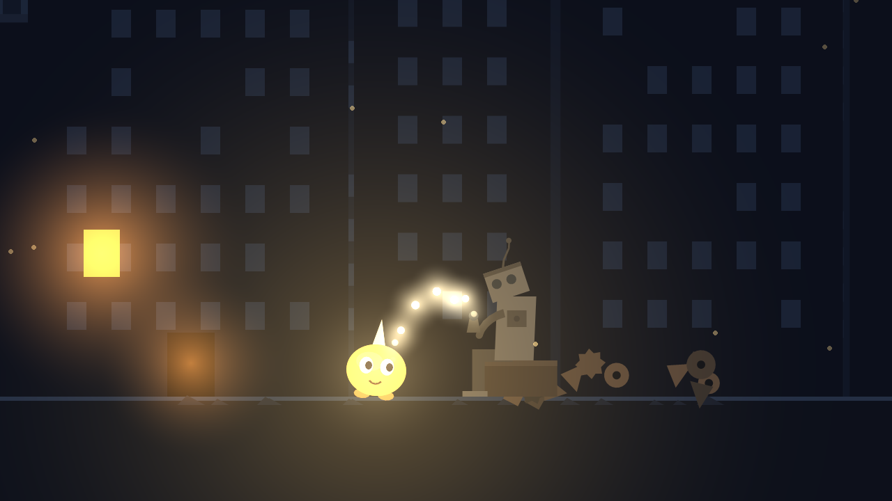
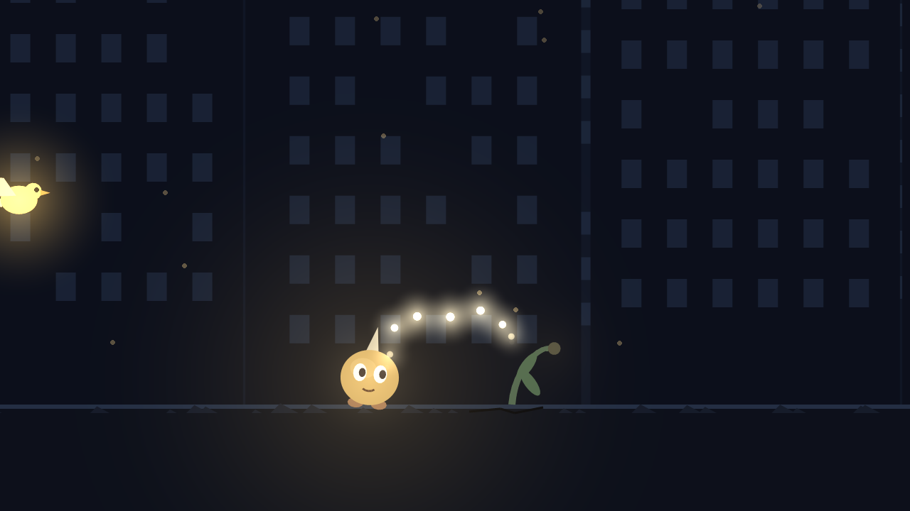
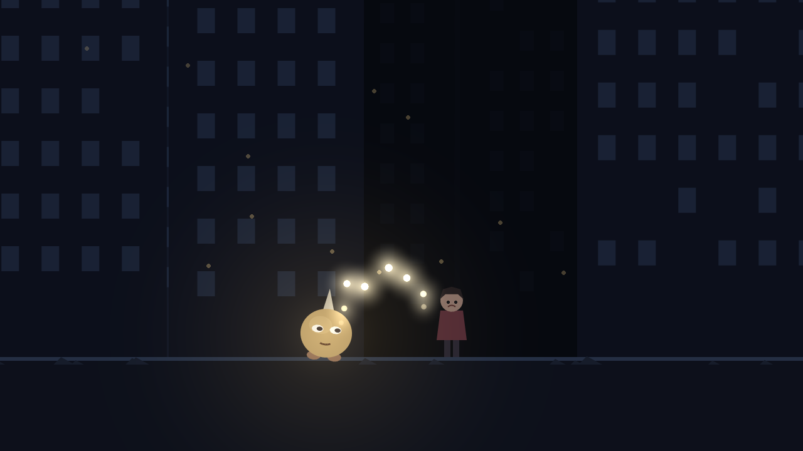
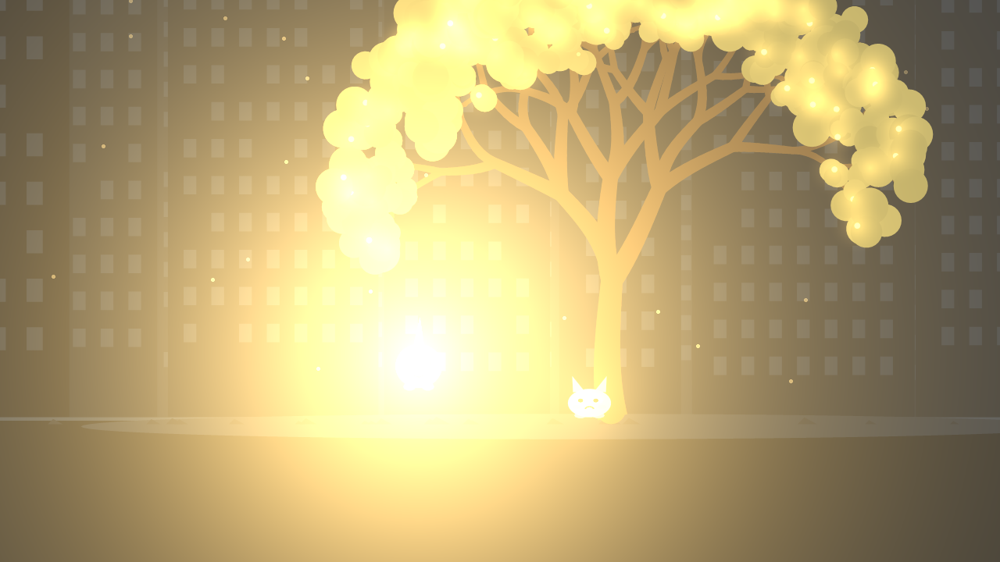
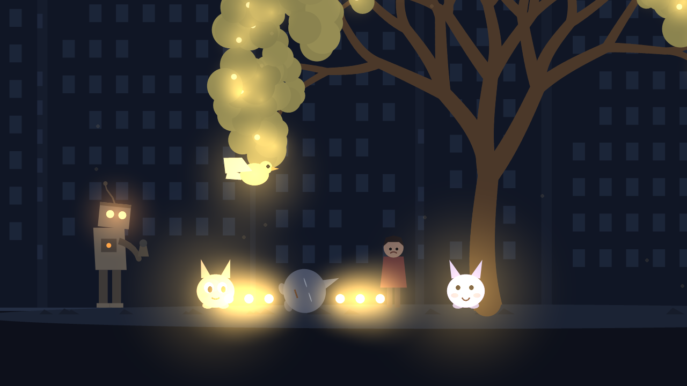
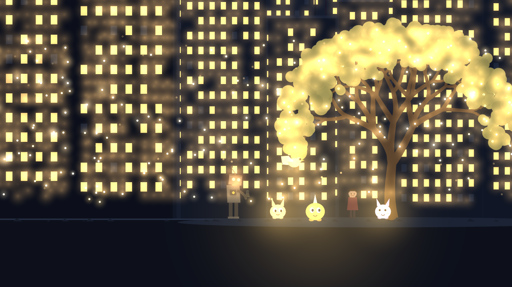
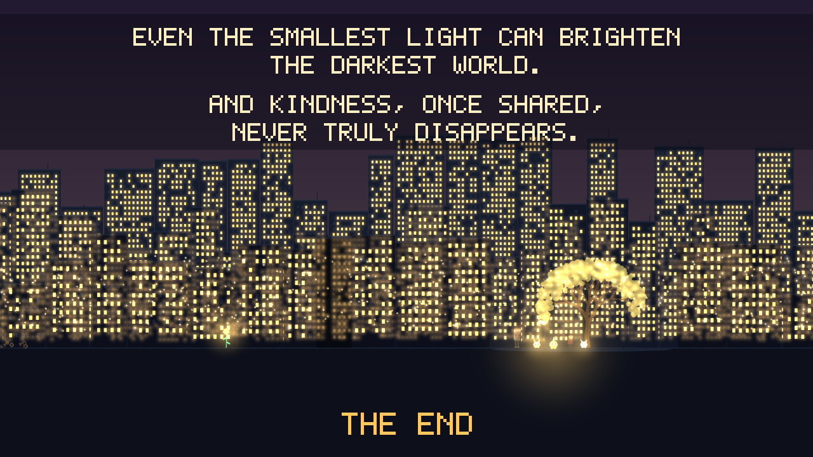

# The Little Light

A 5-minute, dialogue-free animated short written entirely in C++ and OpenGL for our Computer Graphics course.
No images, models or game engine were used: every shape, light and movement is drawn by our own code.




## The story

In a world swallowed by darkness, Lumi, a tiny glowing creature, shares its light with everyone it meets: a lost
creature, an old robot, a trapped bird, a wilting plant and a frightened child. Each act of kindness makes Lumi dimmer.
In a dark square, Lumi gives away its very last light. Then everyone it helped returns, each carrying a tiny
light, and together they bring Lumi back and light up the whole city.

**Genre:** drama / fantasy · **Duration:** 5 minutes · **Style:** 2D lit animation · **Dialogue:** none


## Graphics concepts used

| Stage | Concepts |
|---|---|
| **CP1: pure C++ foundation** | Bresenham line, midpoint circle algorithm, scanline polygon fill (even-odd rule) with 4x anti-aliasing, alpha blending, additive radial glow, floating-point framebuffer |
| **CP2: transformation and animation** | 3x3 homogeneous matrices (translate, rotate, scale, concatenation), matrix stack for hierarchical models, cubic Bezier curves, keyframe animation with monotone cubic Hermite interpolation, parallax camera |
| **CP3: OpenGL** | Fixed-function pipeline, triangle fans, alpha and additive blending, 4x MSAA, GLFW window, real-time playback controls, switchable renderer |

### Architecture

```
scene.h  ->  Canvas (cp2_transform.h: matrix stack, Bezier, shapes)  ->  Renderer interface (renderer.h)
                                                                          |-- SoftwareRenderer  (cp1_raster.h, pure C++)
                                                                          '-- GLRenderer        (cp3_opengl.h, OpenGL)
```

The film only talks to an abstract `Renderer`, so the same animation can be played by our own pure C++
rasteriser or by OpenGL. All transformations are computed by our own `Mat3` class, not by `glTranslate` or `glRotate`.
Every frame is a pure function of time, so seeking and video export are exact.

## Build and run

**Windows (MSYS2 UCRT64 terminal)**
```bash
pacman -S mingw-w64-ucrt-x86_64-gcc mingw-w64-ucrt-x86_64-glfw
g++ -std=c++17 -O2 main.cpp -o little_light.exe -lglfw3 -lopengl32 -lgdi32
./little_light.exe
```

**Linux**
```bash
sudo apt install g++ libglfw3-dev libgl1-mesa-dev
g++ -std=c++17 -O2 main.cpp -o little_light -lglfw -lGL
./little_light
```

**macOS**
```bash
brew install glfw
g++ -std=c++17 -O2 main.cpp -o little_light -lglfw -framework OpenGL
./little_light
```

**CMake (any platform):** `cmake -S . -B build && cmake --build build`

**Pure C++ only (no OpenGL, no libraries):**
```bash
g++ -std=c++17 -O2 -DNO_WINDOW main.cpp -o little_light_software
./little_light_software --shot 58 frame.ppm
```

## Controls

| Key | Action |
|---|---|
| `SPACE` | Pause / resume |
| `LEFT` / `RIGHT` | Jump back / forward 5 seconds |
| `UP` / `DOWN` | Double / halve playback speed |
| `R` | Switch between the OpenGL renderer and the pure C++ renderer |
| `HOME` | Restart |
| `P` | Save `screenshot.ppm` |
| `ESC` | Quit |

## Exporting the video

```bash
./little_light_software --video --fps 30 | ffmpeg -f rawvideo -pix_fmt rgb24 -s 1280x720 -r 30 -i - \
    -c:v libx264 -preset medium -crf 20 -pix_fmt yuv420p little_light.mp4
```

## Project structure

```
little_light/
├── main.cpp           window, controls, video/screenshot export
├── scene.h            the whole film: characters, timeline, camera, lighting
├── cp1_raster.h       CP1: pure C++ rasteriser
├── cp2_transform.h    CP2: matrices, matrix stack, Bezier, animation tracks
├── cp3_opengl.h       CP3: OpenGL renderer and presenter
├── renderer.h         abstract drawing interface
├── common.h           vectors, colours, math helpers
├── font.h             5x7 bitmap font for title and final message
├── CMakeLists.txt     build file
├── CHECKPOINTS.md     checkpoint evidence
└── screenshots/       frames from the film
```

## Screenshots

| 

|  |


|  |


 |


|  | 


 |


|  | 


 |


## What works and known limitations

- The full 5-minute film plays in real time with the OpenGL renderer.
- The pure C++ renderer takes about 40 ms per frame, which is fine for export but slower than real time at 60 fps.
- There is no soundtrack; the storyline suggests soft piano building to orchestral music, to be added in a video editor.
- The OpenGL renderer uses the legacy fixed-function pipeline for simplicity; a shader version would be the next step.

## Acknowledgements

- Story concept: our own storyline "The Little Light".
- Libraries: [GLFW](https://www.glfw.org/) for windowing and input; FFmpeg for video encoding.
